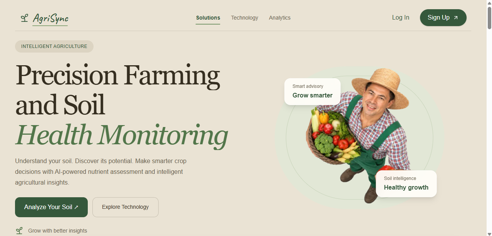
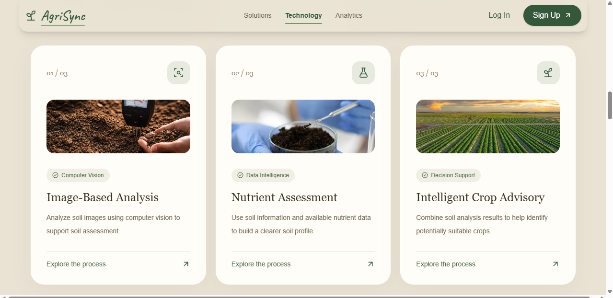
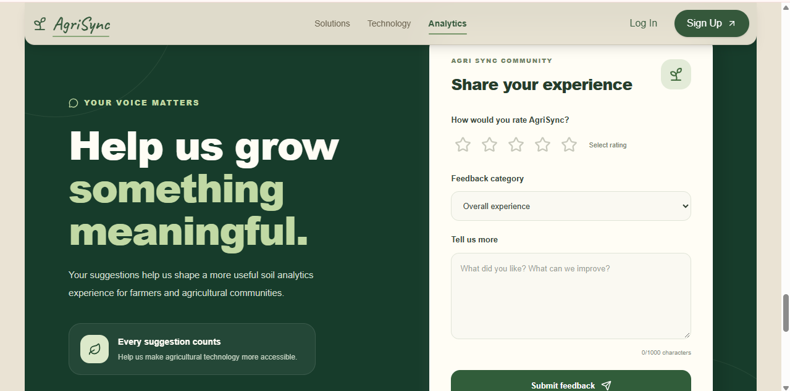
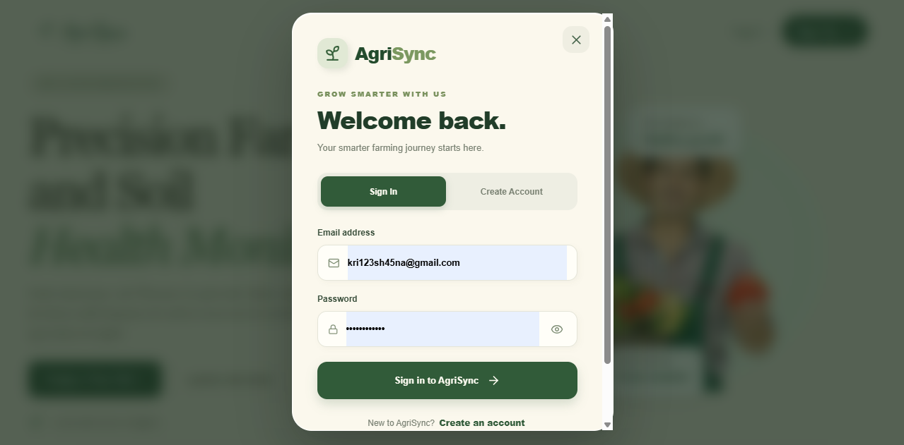
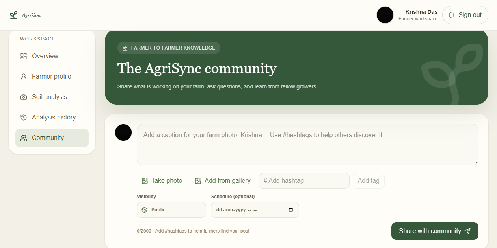
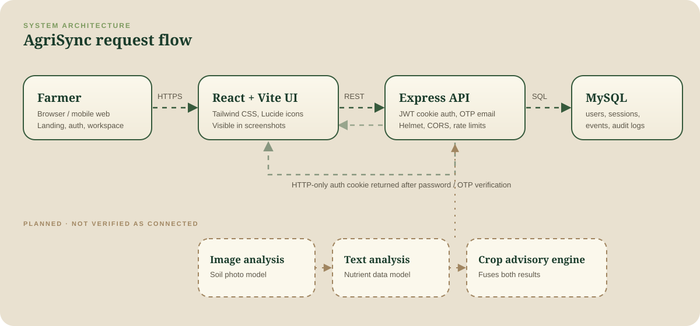
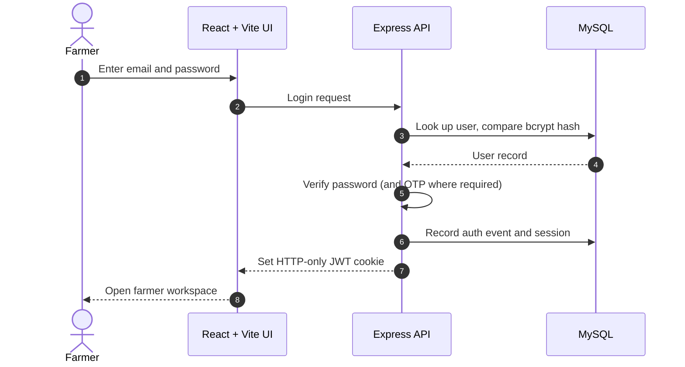
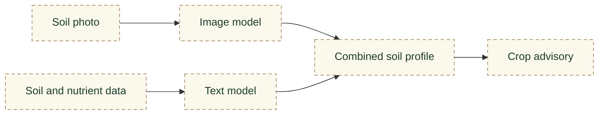

<div align="center">


<br/>

### AI-powered soil analytics and intelligent crop advisory for farmers

<br/>


<br/>

**[About](#-about)** &nbsp;·&nbsp;
**[Screenshots](#-screenshots)** &nbsp;·&nbsp;
**[Architecture](#-architecture)** &nbsp;·&nbsp;
**[Security](#-authentication-and-security)** &nbsp;·&nbsp;
**[Database](#-database)** &nbsp;·&nbsp;
**[Quick Start](#-quick-start)** &nbsp;·&nbsp;
**[Roadmap](#-roadmap)**

</div>


## 🌱 About

**AgriSync** helps farmers understand their soil, assess nutrient conditions, and receive crop-related guidance through a simple, farmer-friendly web platform. It also includes a **community space** where growers share farm photos, ask questions, and learn from each other.

The intended analysis direction combines two approaches into one advisory experience:

| Approach | Goal |
|---|---|
| 📷 **Image-based analysis** | Assess soil from photographs using computer vision |
| 🧪 **Text and data-based analysis** | Build a nutrient profile using machine learning |
| 🌾 **Combined advisory** | Merge both results into crop suggestions |

> [!NOTE]
> This README separates what is **visible in the current UI** from what is **planned**. AI/ML integration is part of the intended direction and is not presented as complete.

### Status legend

| Symbol | Meaning |
|---|---|
| ✅ | Visible in the UI (a screenshot exists) |
| 🔧 | Designed in the project brief; confirm against source |
| 🧭 | Planned |

### At a glance

| Area | Capability | Status |
|---|---|---|
| Landing | Solutions, Technology, and Analytics sections | ✅ |
| Landing | Feedback form: star rating, category, up to 1000 characters | ✅ |
| Auth | Sign In / Create Account modal with password visibility toggle | ✅ |
| Workspace | Overview, Farmer profile, Soil analysis, Analysis history, Community | ✅ |
| Community | Post composer: caption, hashtags, camera or gallery photo, visibility, scheduling | ✅ |
| Backend | Password hashing, JWT cookies, email OTP, rate limiting, activity tables | 🔧 |
| AI | Nutrient-based crop advisory using the trained crop model and persisted analysis history | ✅ |
| AI | Image classification and combined image/data advisory | 🧭 |

> "Visible in the UI" does not confirm the backend behind it is complete.


## 🌾 Core Capabilities

<p align="center">
  
</p>


## 📸 Screenshots

<p align="center">
  
  <br/><sub><b>Landing page.</b> "Precision Farming and Soil Health Monitoring" with a clear Analyze Your Soil call to action.</sub>
</p>

<table>
  <tr>
    <td width="50%" align="center">
      
      <br/><sub><b>Technology.</b> Image analysis, nutrient assessment, and crop advisory cards.</sub>
    </td>
    <td width="50%" align="center">
      
      <br/><sub><b>Community feedback.</b> Rating, category, and comment form.</sub>
    </td>
  </tr>
  <tr>
    <td width="50%" align="center">
      
      <br/><sub><b>Authentication.</b> Sign In and Create Account tabs.</sub>
    </td>
    <td width="50%" align="center">
      
      <br/><sub><b>Farmer workspace.</b> Sidebar navigation and post composer.</sub>
    </td>
  </tr>
</table>

<details>
<summary><b>Screenshots still to add</b></summary>

| Section | Placeholder path |
|---|---|
| Soil analysis dashboard | `docs/screenshots/dashboard.png` |
| Analysis results | `docs/screenshots/soil-analysis.png` |
| Crop advisory | `docs/screenshots/crop-advisory.png` |
| Responsive / mobile view | `docs/screenshots/responsive.png` |

</details>


## 🏗 Architecture

<p align="center">
  
</p>

Solid animated lines show the web request flow. Dashed boxes are **planned** AI services and are not claimed as connected.

<details open>
<summary><b>Authentication flow</b></summary>



</details>

<details>
<summary><b>Planned analysis pipeline</b></summary>



Every node is **planned**. Update this once model services are connected to the API.

</details>


## 🧰 Technology Stack

| Layer | Technologies |
|---|---|
| **Frontend** | React.js, Vite, Tailwind CSS, Lucide React, GSAP (where used) |
| **Backend** | Node.js, Express.js, MySQL |
| **Auth and security** | JWT, bcryptjs, HTTP-only cookies, email OTP, Express Rate Limit, Helmet, CORS |
| **AI/ML** | Image-based and text-based analysis are the intended direction. Frameworks, models, and datasets are to be documented from source. |

**Design palette**


`#1A3C2B` · `#365A3C` · `#7C9A5E` · `#FBF8EC` · `#E9E1D0` · `#6B4A2E`


## 🔐 Authentication and Security

| Control | Purpose |
|---|---|
| **bcryptjs** | Stores password hashes instead of plain text |
| **JWT in HTTP-only cookies** | Keeps the token out of reach of client-side scripts |
| **Email OTP** | Verifies control of an email address in selected flows |
| **Rate limiting** | Slows brute-force attempts on sensitive endpoints |
| **Helmet** | Sets protective HTTP response headers |
| **Configurable CORS** | Restricts which origins may call the API |
| **Token-version invalidation** | Allows older tokens to be invalidated server-side |
| **Activity tables** | Record sessions, auth events, user activity, and audit entries |

> [!IMPORTANT]
> - Email OTP is **email verification**, not two-factor authentication.
> - Google OAuth, mandatory 2FA, enforced session limits, automatic session revocation, and complete audit coverage are **not claimed**. Confirm each in the source before listing it.
> - No system is immune to attack. Treat this list as a baseline, not a guarantee.

**Recommended future hardening:** optional TOTP or passkey second factor, user-facing session management, secret and dependency scanning in CI, and security-focused automated tests.


## 🗄 Database

| Table | Purpose |
|---|---|
| `users` | Core account records the tracking tables relate to |
| `user_sessions` | Session identifiers, login method, timestamps, expiry, and termination details |
| `auth_events` | Authentication successes, failures, OTP events, and other security events |
| `user_activity_events` | User activity with page paths and optional metadata |
| `audit_logs` | Records of application actions and related audit information |

Column-level documentation and foreign keys will be added once the SQL schema is reviewed.

<details>
<summary><b>Read-only inspection queries</b></summary>

```sql
-- List all tables
SHOW TABLES;

-- Inspect structures
DESCRIBE users;
DESCRIBE user_sessions;
DESCRIBE auth_events;
DESCRIBE user_activity_events;
DESCRIBE audit_logs;

-- Recent authentication events (verify column names first)
SELECT * FROM auth_events ORDER BY 1 DESC LIMIT 20;

-- Session history for one user (replace 1 with a real user id)
SELECT * FROM user_sessions WHERE user_id = 1 ORDER BY 1 DESC LIMIT 20;

-- Recorded activity (verify column names first)
SELECT * FROM user_activity_events ORDER BY 1 DESC LIMIT 20;
```

Avoid publishing output that contains real emails, IP addresses, or tokens.

</details>


## 🚀 Quick Start

Written for **Windows + VS Code**. Folder names and scripts marked *verify* must be checked against your `package.json` files.

**Prerequisites:** [Node.js LTS](https://nodejs.org), [MySQL Server](https://dev.mysql.com/downloads/), [Git](https://git-scm.com), [VS Code](https://code.visualstudio.com)

```bash
# 1. Clone
git clone https://github.com/<your-username>/agrisync.git
cd agrisync
```

```sql
-- 2. Create the database, then run your schema file in MySQL Workbench
CREATE DATABASE agrisync_db;
```

```bash
# 3. Backend (verify folder name and script)
cd server
npm install
copy .env.example .env
npm run dev
```

```bash
# 4. Frontend, in a second terminal (verify folder name)
cd client
npm install
npm run dev
```

**5. Health check.** Vite normally serves at `http://localhost:5173`. Open your API health route, for example `http://localhost:5000/api/health` *(verify)*, then load the frontend and confirm the landing page appears.

### Environment variables

Create `server/.env`. **Never commit this file.**

```env
PORT=5000
FRONTEND_URL=http://localhost:5173

DB_HOST=localhost
DB_PORT=3306
DB_USER=your_mysql_user
DB_PASSWORD=your_mysql_password
DB_NAME=agrisync_db

JWT_SECRET=replace_with_a_long_random_secret

# Only if Google OAuth is implemented
GOOGLE_CLIENT_ID=configure_if_google_oauth_is_implemented

EMAIL_USER=your_email_address
EMAIL_APP_PASSWORD=your_email_app_password
```

```gitignore
.env
node_modules/
```

<details>
<summary><b>Project structure (placeholders to verify)</b></summary>

```text
agrisync/
├── client/        # React + Vite frontend
├── server/        # Express API and .env.example
├── database/      # SQL schema files
├── docs/
│   ├── assets/        # animated SVGs
│   └── screenshots/   # UI screenshots
└── README.md
```

</details>

<details>
<summary><b>Implemented API endpoints</b></summary>

| Method | Path | Purpose | Auth |
|---|---|---|---|
| POST | `/api/auth/signup` | Start account creation | No |
| POST | `/api/auth/signin` | Sign in | No |
| POST | `/api/auth/verify-otp` | Verify signup OTP | No |
| POST | `/api/auth/forgot-password` | Request password reset OTP | No |
| POST | `/api/auth/reset-password` | Reset password | No |
| POST | `/api/auth/logout` | End the current session | Yes |
| POST | `/api/soil-analysis` | Validate nutrient values, recommend a crop, and save analysis | Yes |
| GET | `/api/soil-analysis/history` | List the current farmer's latest 50 analyses | Yes |
| DELETE | `/api/soil-analysis/:analysisId` | Delete the current farmer's analysis | Yes |

</details>

<details>
<summary><b>Troubleshooting</b></summary>

| Problem | Check |
|---|---|
| MySQL connection refused | Service is running; `DB_HOST`, `DB_PORT`, `DB_USER`, `DB_PASSWORD` are correct |
| Unknown database | Run `CREATE DATABASE agrisync_db;` and import the schema |
| CORS error | `FRONTEND_URL` exactly matches the Vite origin, including port |
| Logged in but appears logged out | Cookie `sameSite` and `secure` settings; frontend sends `credentials: 'include'` |
| OTP email not arriving | Use an app password, not your normal password; check spam |
| Env vars undefined | `.env` is in the folder the server starts from; restart after editing |
| Frontend cannot reach API | Backend runs on the expected `PORT`; API base URL is correct |

</details>


## 🗺 Roadmap

<p align="center">
  
</p>

- [x] Landing page, authentication UI, community workspace UI, feedback form (visible in screenshots)
- [x] Verify and document implemented backend routes
- [x] Connect image-based soil classification and Groq crop recommendations
- [x] Connect text-based nutrient assessment
- [x] Combine nutrient results into crop recommendations
- [x] Analysis history and improved analytics
- [ ] Multilingual and voice-assisted interaction
- [ ] Stronger session-management controls
- [ ] Automated tests and CI/CD deployment

### Known limitations

The nutrient advisory calls the trained scikit-learn crop model through `ml_backend/predict_crop.py`. Image analysis calls `ml_backend/predict_soil_image.py`, which expects TensorFlow and the checked-in `models/image/best_soil_classifier_finetuned.keras` model. Install `ml_backend/requirements-image.txt` in the Python environment used by `ML_PYTHON_PATH` (or set that variable to the environment where TensorFlow is installed). The image result is sent to Groq using `GROQ_API_KEY`; optionally set `GROQ_MODEL`. Apply `Backend/config/db-schema.sql` before using the nutrient analysis/history endpoints. The backend automatically tries `python` and then `py -3` on Windows when `ML_PYTHON_PATH` is not set. Automated tests and deployment workflows are not yet documented. Several screenshots are pending.


## 🤝 Contributing

1. Fork the repository.
2. Create a branch: `git checkout -b feature/your-feature`.
3. Commit with a clear message.
4. Open a pull request describing what changed and why.

Never commit secrets, real user data, or `.env` files.

## 🔒 Security Reporting

Found a vulnerability? Please **do not open a public issue**. Contact the maintainer privately (add your email, or enable GitHub private vulnerability reporting).

## 📄 License

Add a license (for example MIT) as `LICENSE` in the repository root, then update this section.

<br/>


